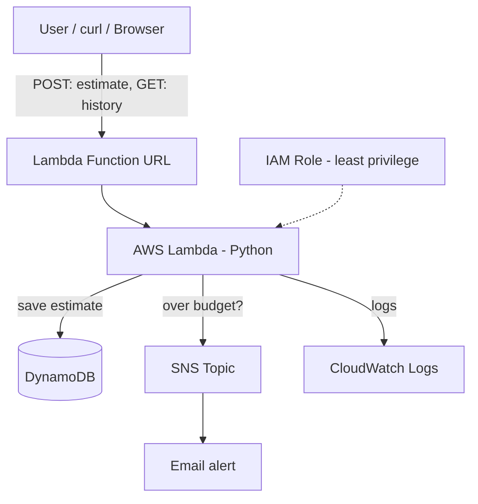

# Serverless AWS Cost Estimator with History and Budget Alerts

A serverless API built on **AWS Lambda (Python)** that estimates the monthly cost of common AWS services, saves every estimate in **DynamoDB**, and sends an **SNS email alert** when the estimate goes over a budget.

> Prices used are **approximate** (US East, On-Demand) and are meant for learning and estimation only. Always verify with the official [AWS Pricing Calculator](https://calculator.aws).

## Architecture



## Features
- Estimates monthly cost for **EC2, S3, Lambda and data transfer**
- Optional **free tier** calculation (`apply_free_tier`)
- Saves every estimate in **DynamoDB** with ID and timestamp
- Sends an **email alert via SNS** when the total exceeds `BUDGET_LIMIT`
- `GET` request returns the **last 10 estimates**
- Input validation with clear error responses (HTTP 400)
- Logging with **CloudWatch**
- **Least-privilege IAM** policy (only the permissions it needs)

## Tech Stack
Python 3.12, AWS Lambda, Lambda Function URL, Amazon DynamoDB, Amazon SNS, Amazon CloudWatch, AWS IAM

## API

### POST: create an estimate
Request body:
```json
{
  "ec2_hours": 730,
  "ec2_type": "t3.micro",
  "s3_gb": 50,
  "lambda_requests": 2000000,
  "lambda_memory_mb": 512,
  "lambda_duration_ms": 200,
  "data_transfer_gb": 150,
  "apply_free_tier": false
}
```
Example response:
```json
{
  "currency": "USD",
  "free_tier_applied": false,
  "breakdown": {"EC2": 7.59, "S3": 1.15, "Lambda": 3.73, "DataTransfer": 13.5},
  "total_monthly_cost": 25.97,
  "budget_limit": 20.0,
  "over_budget": true
}
```
Supported `ec2_type` values: `t3.micro`, `t3.small`, `t3.medium`.

### GET: history
Returns the 10 most recent saved estimates.

## How the cost is calculated
| Service | Formula |
|---|---|
| EC2 | hours x price per hour |
| S3 | GB stored x price per GB-month |
| Lambda | request charge + compute charge (requests x memory in GB x duration in seconds = GB-seconds) |
| Data transfer | GB out to internet x price per GB |

With the free tier enabled, the monthly free allowance is subtracted before pricing.

## Setup
1. **DynamoDB:** create table `CostEstimates` with partition key `id` (String), on-demand capacity.
2. **SNS:** create a Standard topic `BudgetAlerts`, add an Email subscription, and confirm it from your inbox.
3. **Lambda:** create a Python 3.12 function and paste the code from `cost_estimator_pro.py` (keep the console file name `lambda_function.py`).
4. **Environment variables:**

   | Key | Example |
   |---|---|
   | `TABLE_NAME` | `CostEstimates` |
   | `TOPIC_ARN` | your SNS topic ARN |
   | `BUDGET_LIMIT` | `20` |

5. **IAM:** attach the inline policy from `iam-policy.json` (replace the placeholders).
6. **Function URL** (optional): enable it for HTTP access.
7. **Test:** use `test-event.json` in the Lambda Test tab.

Use the **same AWS region** for all services.

## Security Notes
- The Lambda role has only `dynamodb:PutItem`, `dynamodb:Scan` on one table and `sns:Publish` on one topic.
- The Function URL in this demo used auth type `NONE`, so anyone with the link could call it. For real use, put the function behind **API Gateway with an API key or IAM/Cognito authentication**, or use the `AWS_IAM` auth type.
- No credentials are stored in the code. Configuration comes from environment variables.

## Cost
Designed to stay within the AWS Free Tier at demo scale. Lambda, DynamoDB and CloudWatch have free monthly allowances. A budget alert is recommended on any AWS account.

## Screenshots
Add your screenshots to a `screenshots/` folder and link them here:
- DynamoDB table
- SNS subscription confirmed
- Lambda test result
- Alert email
- CloudWatch logs

## Possible Improvements
- Use `Query` with a sort key or index instead of `Scan` for history
- Add API Gateway with authentication
- Define the infrastructure as code (AWS SAM or Terraform)
- Support more services (RDS, DynamoDB) and regions
- Fetch live prices from the AWS Price List API


